# SportHub — Hệ thống quản lý trung tâm thể thao đa môn

**Đồ án SWP391** · Gym, cầu lông và bóng rổ · Giao diện tiếng Anh

[](https://github.com/SWP391-SportHub-Group4/sports-center-management-system/actions/workflows/ci.yml)
  

**Tài liệu kỹ thuật:** [sportHub-docs](https://github.com/SWP391-SportHub-Group4/sportHub-docs) · [Mục lục tài liệu](https://github.com/SWP391-SportHub-Group4/sportHub-docs/blob/main/README.md).

SportHub kết nối những công việc thường bị tách rời ở một trung tâm thể thao: khách đăng ký dịch vụ, lễ tân bán hàng và check-in, huấn luyện viên theo dõi lớp, quản lý điều hành và quản trị viên kiểm soát tài khoản. Tùy dịch vụ, hóa đơn có thể thanh toán bằng ví điểm, VNPay hoặc kết hợp cả hai; lịch sân và lớp được kiểm soát để tránh đặt trùng hay vượt sức chứa.

**Trải nghiệm web:** [SportHub](https://sports-center-management-system-tawny.vercel.app/)

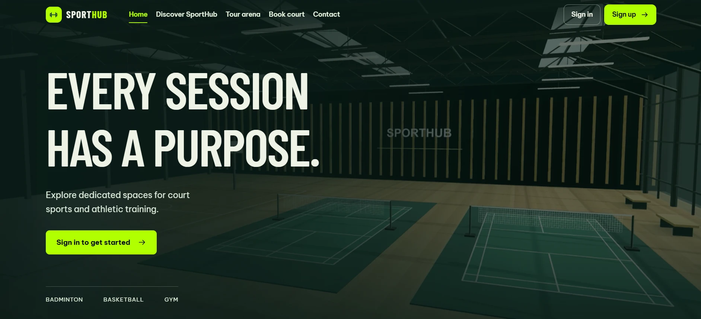

## SportHub làm được gì?

| Vai trò | Công việc chính |
| --- | --- |
| **Hội viên** | Khám phá dịch vụ, mua gói Gym hoặc vé ngày, đăng ký lớp, thuê sân, xem lịch và hóa đơn, quản lý ví điểm và hồ sơ tập luyện. |
| **Lễ tân** | Tìm và đăng ký hội viên, bán gói, hỗ trợ checkout, check-in Gym, điểm danh, theo dõi lịch sân và đối soát thanh toán. |
| **Huấn luyện viên** | Xem lịch dạy, danh sách học viên, điểm danh, quản lý quan hệ huấn luyện và kế hoạch tập. |
| **Quản lý trung tâm** | Quản lý môn thể thao, phòng/sân, lớp, huấn luyện viên, chính sách vận hành, báo cáo và yêu cầu hỗ trợ. |
| **Quản trị hệ thống** | Tạo và quản lý tài khoản nhân sự, phân quyền, kích hoạt/vô hiệu hóa tài khoản và xem nhật ký thao tác. |

Khách chưa đăng nhập có thể xem trang chủ và nội dung công khai. Các trang nghiệp vụ yêu cầu đăng nhập đúng vai trò.

## Màn hình

Ảnh dưới đây chụp từ **ứng dụng local** (frontend cổng `3000`). Trang theo vai trò chỉ mở được khi đăng nhập đúng tài khoản.

### Khách

Trang chủ công khai giới thiệu các môn, sơ đồ khu tập và câu hỏi thường gặp. Khách đăng nhập hoặc đăng ký hội viên bằng email hay Google.

| | |
| --- | --- |
| 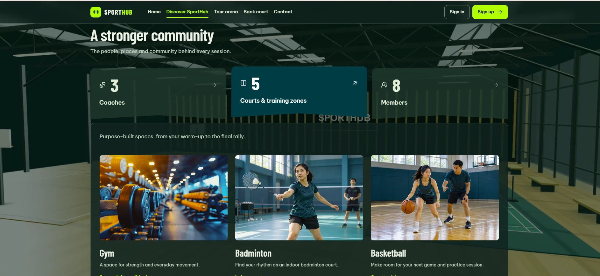 | 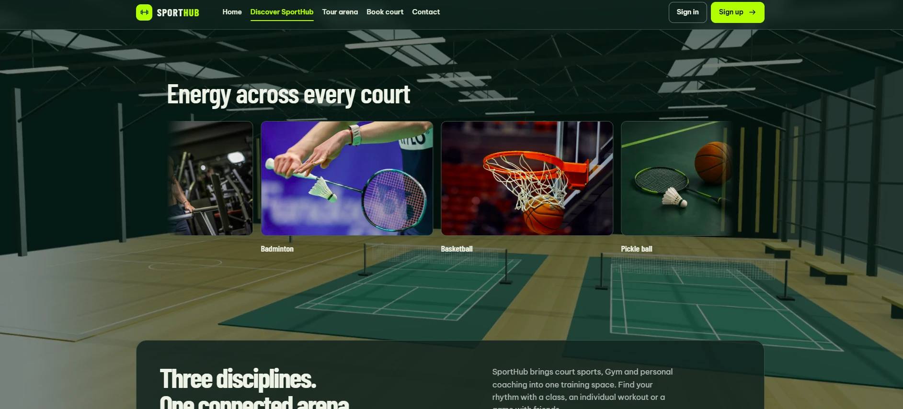 |
| 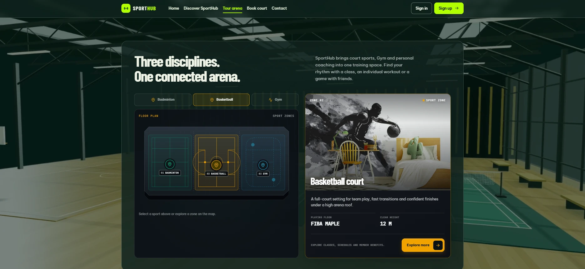 | 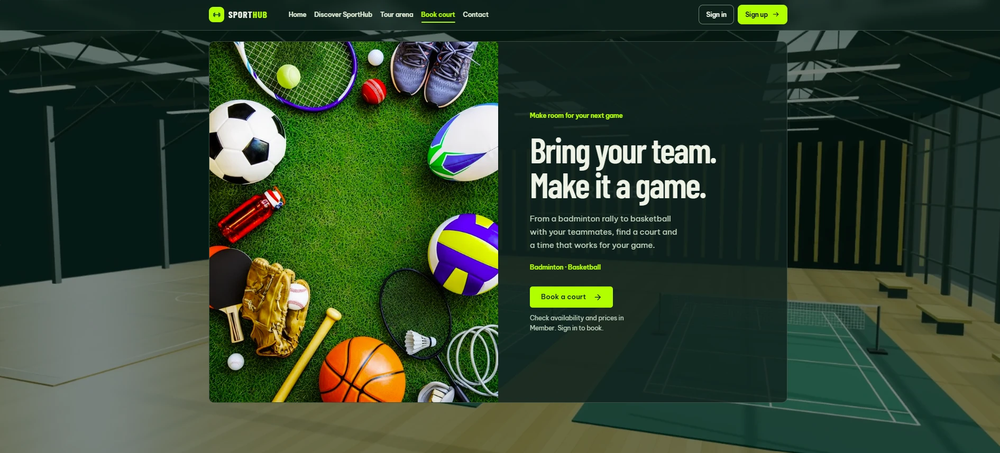 |
| 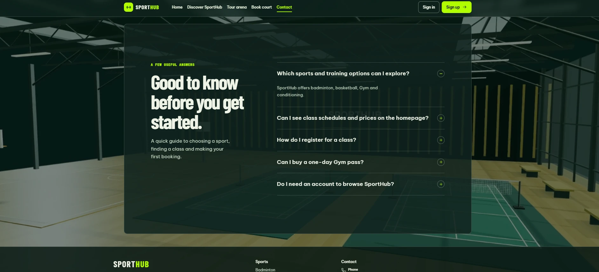 | |

| Đăng nhập | Đăng ký hội viên |
| --- | --- |
|  |  |

### Hội viên

**Tổng quan** · [`/member`](http://localhost:3000/member): hóa đơn chờ thanh toán, lối tắt, lịch sắp tới và gói đang dùng.

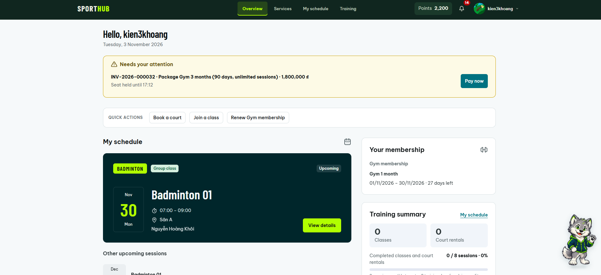

**Dịch vụ** · [`/member/services`](http://localhost:3000/member/services): khám phá gói Gym, lớp nhóm và thuê sân; tab *My services* hiển thị dịch vụ đang sở hữu.

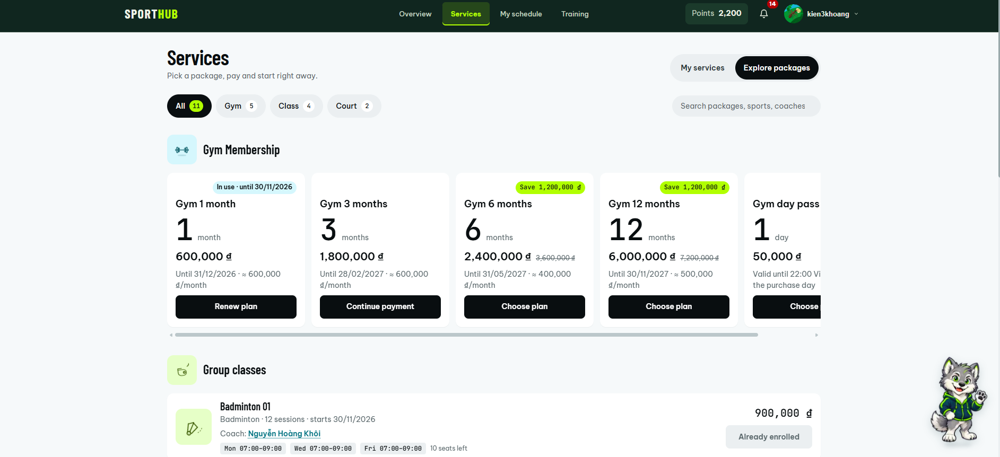
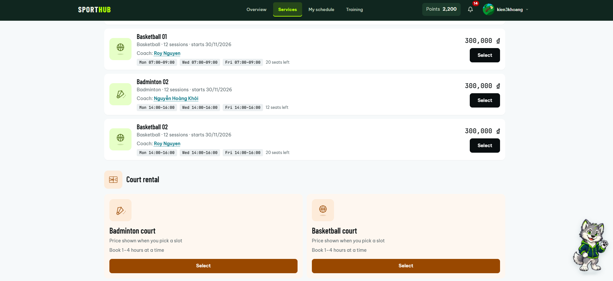
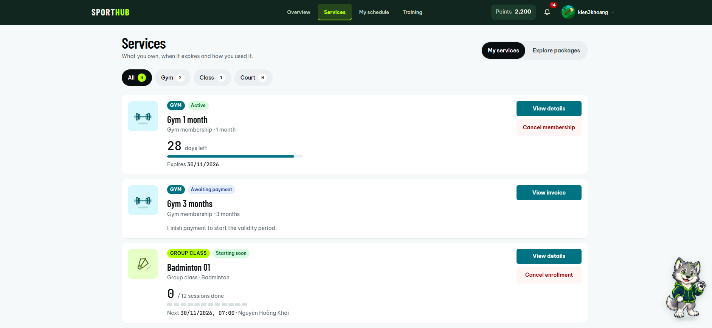

**Lịch cá nhân** · [`/member/schedule`](http://localhost:3000/member/schedule): lịch lớp và lượt thuê sân theo tháng, bấm vào buổi để xem chi tiết.

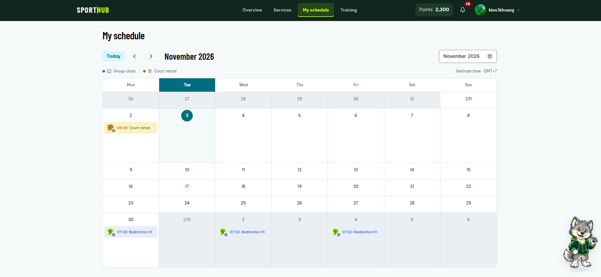
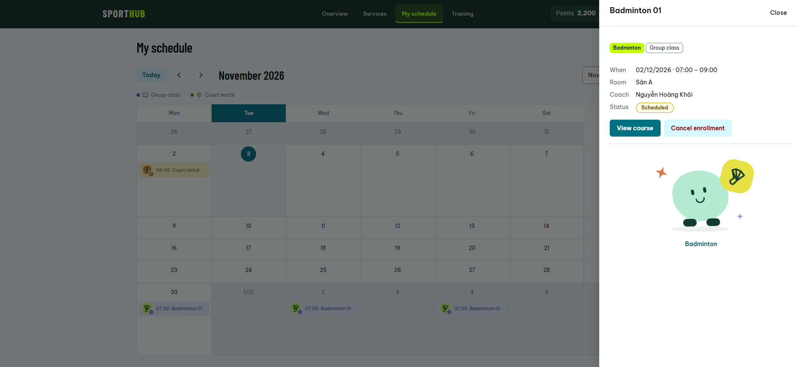

**Tài chính** · [`/member/finance`](http://localhost:3000/member/finance): ví điểm, lịch sử điểm và hóa đơn.

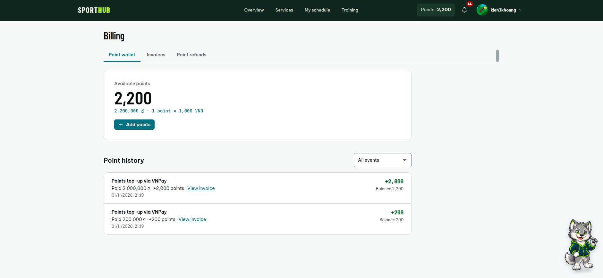
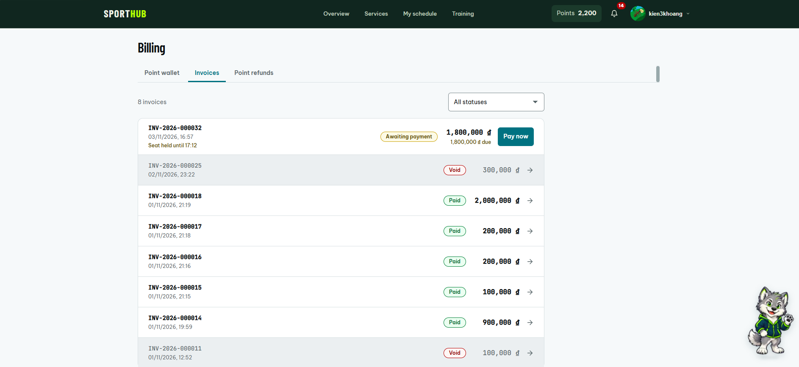

**Hỗ trợ** · theo dõi yêu cầu đã gửi và mốc phản hồi.

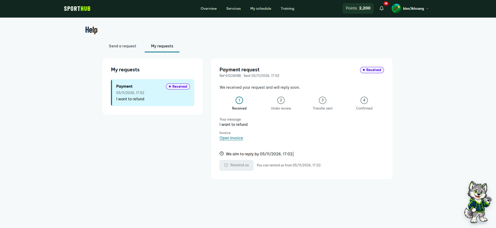

### Lễ tân

**Quầy hôm nay** · [`/receptionist`](http://localhost:3000/receptionist): tìm hội viên hoặc quét mã QR check-in, xem lớp và lượt thuê sân sắp tới.

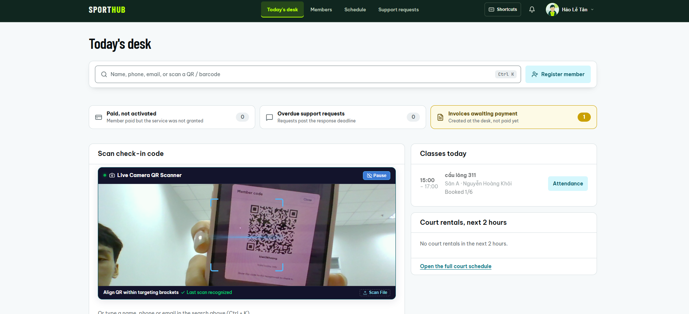
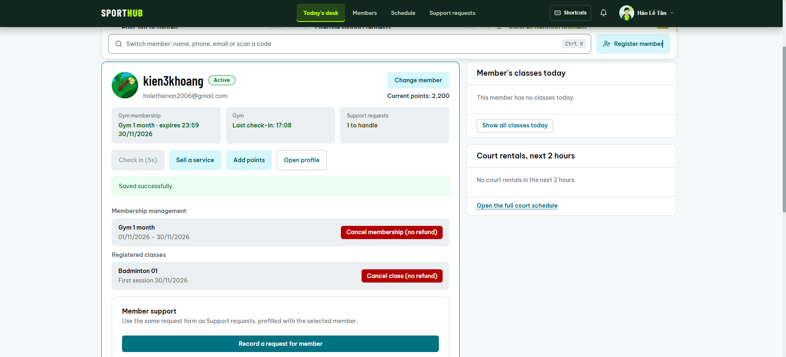

**Check-in Gym** · [`/receptionist/gym-checkin`](http://localhost:3000/receptionist/gym-checkin)

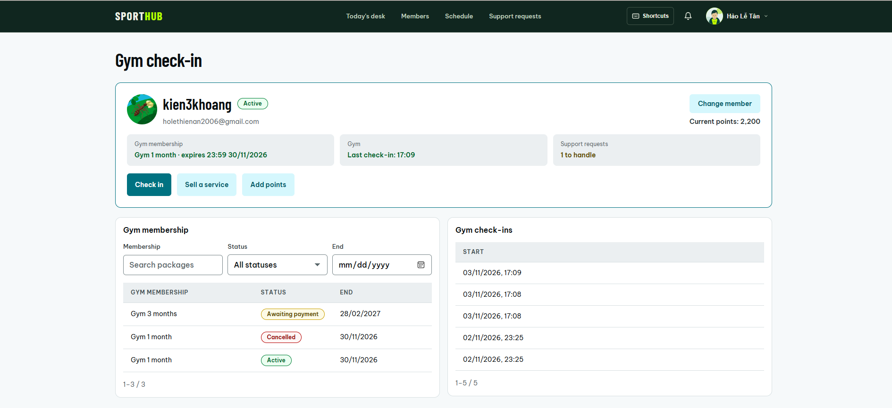

**AI tập luyện** · [`/member/workout-suggestions`](http://localhost:3000/member/workout-suggestions) và trợ lý AI trong khu vực hội viên.

<!-- TODO: thêm ảnh assets/screenshots/member-ai.png -->

### Huấn luyện viên

**Lớp được phân công** · [`/coach/classes`](http://localhost:3000/coach/classes): lớp sắp dạy, sĩ số, buổi học kế tiếp.

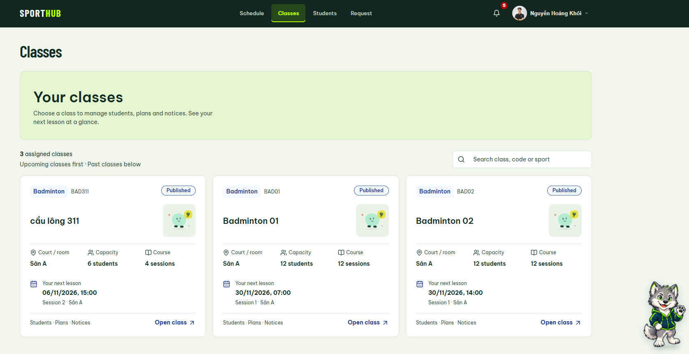

**Chi tiết lớp** · học viên, giáo án từng buổi, kế hoạch cá nhân và thông báo.

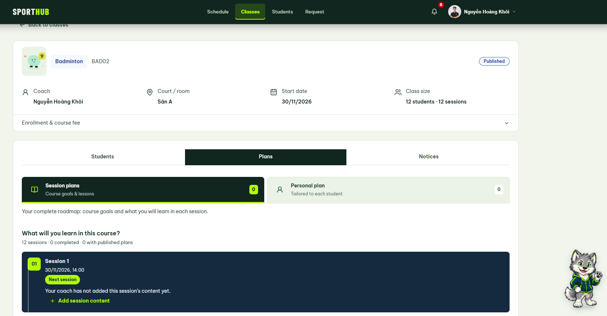

**Trợ lý AI** cho huấn luyện viên.

<!-- TODO: thêm ảnh assets/screenshots/coach-ai.png -->

### Quản lý

**Tổng quan** · [`/manager`](http://localhost:3000/manager): doanh thu thu được, lớp cần xem xét, hội viên Gym đang hoạt động, biểu đồ thu theo ngày và nguồn thu, đặt sân.

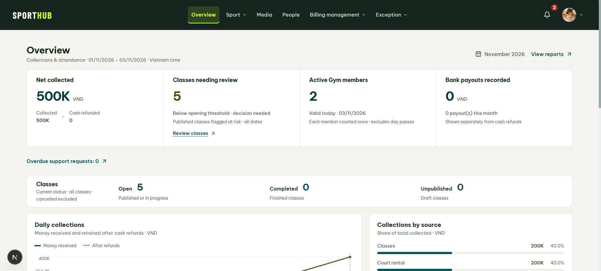
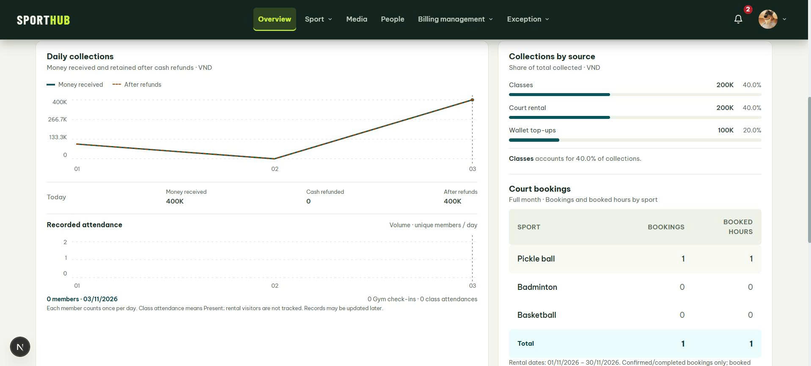

### Quản trị

**Tổng quan** · [`/admin`](http://localhost:3000/admin): theo dõi lời mời kích hoạt nhân sự, tài khoản đang hoạt động hoặc bị vô hiệu hóa, hoạt động gần đây và số tài khoản theo vai trò.

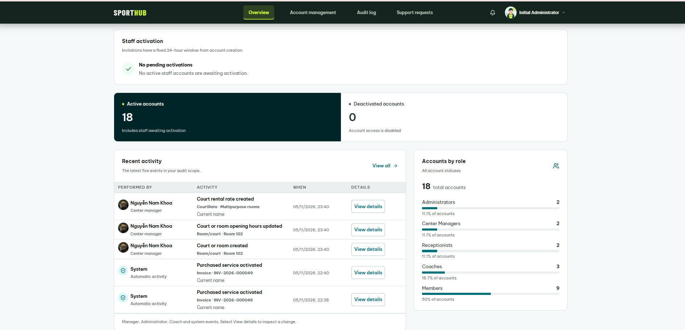

> Trang theo vai trò sẽ chuyển về đăng nhập hoặc từ chối truy cập nếu tài khoản không có quyền tương ứng.

## 6 flow chính

| Flow | Mục đích và thao tác chính |
| --- | --- |
| **1. Tài khoản, phân quyền và Membership Gym** | Khách đăng ký, xác thực và đăng nhập; Admin quản lý tài khoản nhân sự và vai trò; hội viên mua/gia hạn Membership Gym hoặc vé ngày và dùng quyền lợi tại quầy. |
| **2. Lớp học, giữ chỗ và lịch sân** | Quản lý tạo lớp, phân công Coach và xếp phòng/sân; hội viên đăng ký lớp hoặc thuê sân. Hệ thống kiểm tra sức chứa, lịch trống và giữ chỗ trong lúc checkout. |
| **3. Hóa đơn, ví điểm, thanh toán và báo cáo** | Tạo hóa đơn, thanh toán bằng điểm, VNPay hoặc kết hợp; xác minh giao dịch trước khi cấp dịch vụ, đối soát và xử lý hoàn điểm. Quản lý theo dõi doanh thu và báo cáo. |
| **4. Coach lập kế hoạch, điểm danh và kết quả** | Coach xem lớp được phân công, lập giáo án/kế hoạch tập, giao bài tập, điểm danh và ghi kết quả cho học viên; hội viên xem nội dung thuộc lớp mình có quyền truy cập. |
| **5. Gợi ý bài tập AI** | Hội viên nhận gợi ý tập luyện dựa trên thông tin và lịch sử được phép sử dụng; Coach có thể nhận bản nháp gợi ý theo buổi hoặc cho học viên được phân công rồi tự xem, sửa trước khi lưu. Gợi ý AI không tự trở thành giáo án đã duyệt. |
| **6. Trợ lý AI theo ngữ cảnh tài khoản** | Member và Coach hỏi về chức năng, lịch và dữ liệu nghiệp vụ thuộc phạm vi quyền của mình; trợ lý trả lời theo ngữ cảnh được cấp, không tự thực hiện thay đổi dữ liệu. |

Quy tắc nghiệp vụ đầy đủ, bao gồm giữ chỗ, hoàn/bù điểm, phân quyền và điều kiện kích hoạt dịch vụ, nằm trong [Business Rules](https://github.com/SWP391-SportHub-Group4/sportHub-docs/blob/main/requirements/SportManagement_BusinessRules_v2.0_updated.docx) và [thiết kế hệ thống](https://github.com/SWP391-SportHub-Group4/sportHub-docs/blob/main/architecture/Center-Management-System-Design-v3.md).

## Kiến trúc hệ thống

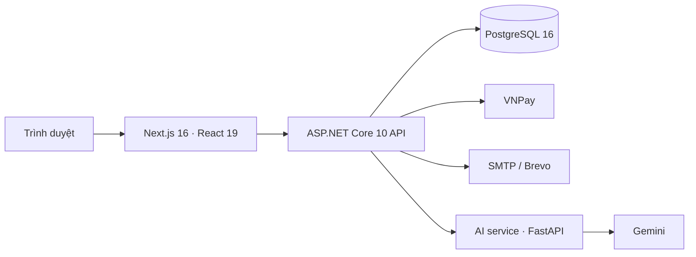

Backend là **modular monolith**: `SportHub.API` lắp ghép các module `Identity`, `Membership`, `Scheduling`, `Training`, `Payment`, `Notification`, `AI`, `Audit` và `Administration`. Các module dùng hợp đồng ở `BuildingBlocks` để giữ ranh giới nghiệp vụ. PostgreSQL lưu dữ liệu vận hành; các tác vụ nền trong API xử lý giữ chỗ, hết hạn, thông báo và đối soát.

```text
sports-center-management-system/
├── backend/          ASP.NET Core API, module nghiệp vụ và test
├── frontend/         Next.js, giao diện theo vai trò và Playwright
├── ai-service/       FastAPI cho tác vụ AI
├── assets/           ảnh dùng trong README
├── scripts/          tiện ích phát triển và kiểm tra
└── docker-compose.yml
```

Chi tiết API và quy ước dữ liệu: [API contract](https://github.com/SWP391-SportHub-Group4/sportHub-docs/blob/main/api/api-contract.md) · [Source of Truth](https://github.com/SWP391-SportHub-Group4/sportHub-docs/blob/main/requirements/00-Source-of-Truth.md).

## Chạy local

### Yêu cầu

- Docker Desktop cho PostgreSQL và AI service.
- .NET SDK **10**.
- Node.js **24** và npm **11**.

### 1. Cấu hình

Tại thư mục gốc repository, tạo `.env` từ file mẫu và điền mật khẩu PostgreSQL, chuỗi kết nối cùng `JwtOptions__SecretKey`:

```powershell
Copy-Item .env.example .env
```

CI trên PR vào `main` chạy thêm Playwright với PostgreSQL + backend Development thật và upload report/trace khi fail. Merge `main` chỉ phát hành backend/AI sau khi CI đạt; máy AWS tự cập nhật sau khi kích hoạt CD một lần theo [deploy/aws/CD.md](deploy/aws/CD.md). Hợp đồng API: [API contract](https://github.com/SWP391-SportHub-Group4/sportHub-docs/blob/main/api/api-contract.md).

Để backend local dùng DB đang chạy trên AWS, xem [endpoint public với TLS](deploy/aws/PUBLIC-DATABASE.md) hoặc [SSH tunnel](deploy/aws/LOCAL-DATABASE.md). Chế độ dùng DB chung tắt migration, seed và job nền trên máy local; thao tác qua API vẫn tác động dữ liệu website.

### 2. Khởi động dịch vụ nền

```powershell
docker compose up -d postgres ai-service
```

PostgreSQL mặc định mở ở `localhost:5435`, AI service ở `localhost:8001`. Port có thể đổi qua `.env`.

### 3. Chạy backend

Mở terminal tại gốc repository. Nếu container `backend` đang chiếm cổng `5000`, dừng container đó trước bằng `docker compose stop backend`:

```powershell
dotnet run --project backend/SportHub.API/SportHub.API.csproj -c Release -- --environment=Development --urls=http://localhost:5000 --DataProtection:KeysPath="$PWD/.tmp/local-api-keys"
```

Chạy `Release` là lựa chọn đã được kiểm tra trên máy Windows có chính sách chặn một số DLL Debug. API: [http://localhost:5000/api/health](http://localhost:5000/api/health) · Swagger: [http://localhost:5000/swagger](http://localhost:5000/swagger).

### 4. Chạy frontend

Mở terminal thứ hai:

```powershell
cd frontend
npm ci
npm run dev
```

Truy cập [http://localhost:3000](http://localhost:3000). Nếu API không chạy ở cổng `5000`, đặt `NEXT_PUBLIC_API_BASE_URL` trong `frontend/.env.local` rồi khởi động lại frontend. Hướng dẫn migration, seed dữ liệu, email và triển khai nằm trong [RUNBOOK](https://github.com/SWP391-SportHub-Group4/sportHub-docs/blob/main/operations/RUNBOOK.md).

> Compose cũng có thể build toàn bộ stack bằng `docker compose up -d --build`. Khi sửa backend hoặc frontend chạy trong container, cần build lại image tương ứng để thấy mã mới.

## Kiểm tra chất lượng

CI trên `develop` build và test backend, chạy lint/typecheck/build frontend, sau đó chạy Playwright E2E với API và PostgreSQL. Có thể kiểm tra nhanh tại máy:

```powershell
dotnet test backend/SportHub.sln
cd frontend
npm run lint
npm run typecheck
npm run check:i18n
```

Backend integration test dùng Docker/Testcontainers; hãy mở Docker Desktop trước khi chạy toàn bộ test.

## Tài liệu

Các tài liệu sau được dùng để xác định phạm vi, thiết kế và kiểm chứng hệ thống:

| Tài liệu | Vai trò trong quá trình thiết kế |
| --- | --- |
| [RUNBOOK](https://github.com/SWP391-SportHub-Group4/sportHub-docs/blob/main/operations/RUNBOOK.md) | Cài đặt local, cấu hình tích hợp, migration và triển khai. |
| [Thiết kế hệ thống](https://github.com/SWP391-SportHub-Group4/sportHub-docs/blob/main/architecture/Center-Management-System-Design-v3.md) | Phạm vi, kiến trúc, dữ liệu và luồng nghiệp vụ. |
| [Source of Truth](https://github.com/SWP391-SportHub-Group4/sportHub-docs/blob/main/requirements/00-Source-of-Truth.md) | Thuật ngữ, quy ước và thứ tự ưu tiên tài liệu. |
| [Business Rules](https://github.com/SWP391-SportHub-Group4/sportHub-docs/blob/main/requirements/SportManagement_BusinessRules_v2.0_updated.docx) | Quy tắc nghiệp vụ của đồ án. |
| [API contract](https://github.com/SWP391-SportHub-Group4/sportHub-docs/blob/main/api/api-contract.md) | Hợp đồng API giữa frontend và backend. |
| [Use Cases theo flow](https://github.com/SWP391-SportHub-Group4/sportHub-docs/blob/main/usecases/README.md) | Một tài liệu triển khai và kiểm thử cho mỗi Flow 1–6. |
| [Mục lục tài liệu](https://github.com/SWP391-SportHub-Group4/sportHub-docs/blob/main/README.md) | Điểm vào các tài liệu còn lại. |

## Đóng góp

Tạo nhánh từ `develop`, mô tả thay đổi và cách kiểm tra trong Pull Request. Trước khi sửa nghiệp vụ, đọc [Source of Truth](https://github.com/SWP391-SportHub-Group4/sportHub-docs/blob/main/requirements/00-Source-of-Truth.md) cùng [Business Rules](https://github.com/SWP391-SportHub-Group4/sportHub-docs/blob/main/requirements/SportManagement_BusinessRules_v2.0_updated.docx). Không đưa `.env`, khóa bí mật, dữ liệu thật hoặc ảnh chứa thông tin cá nhân vào repository.

---

**SportHub · SWP391**

---

## AI Coach/Member — cập nhật triển khai 02/11/2026

- Chatbox ở UI hiện chỉ nằm trong phạm vi **Member** và **Coach**; không suy ra chatbot cho ba role còn lại từ sự tồn tại của các service backend.
- Coach AI suggestion hỗ trợ bản nháp kế hoạch theo buổi và Personal Plan theo học viên được phân công, với bước validation Goal và Coach review trước Save (theo bản vá mới; cần kiểm chứng runtime sau merge).
- Hướng dẫn nút/page từ AI cần đối chiếu Navigation Knowledge của Member/Coach với frontend thật; contract API không tự cho biết vị trí button.
- System prompt có thể được xuất bản qua `ISystemPromptReader`, và phiên bản prompt được gắn với continuation scope. Xem [AI implementation verification](https://github.com/SWP391-SportHub-Group4/sportHub-docs/blob/main/verification/AI-Member-Coach-Implementation-Verification.md).
