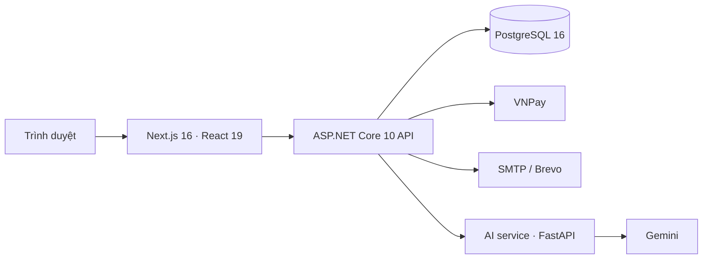

# SportHub — Hệ thống quản lý trung tâm thể thao đa môn

**Đồ án SWP391** · Gym, cầu lông và bóng rổ · Giao diện tiếng Việt và tiếng Anh

[](https://github.com/SWP391-SportHub-Group4/sports-center-management-system/actions/workflows/ci.yml)


SportHub kết nối những công việc thường bị tách rời ở một trung tâm thể thao: khách đăng ký dịch vụ, lễ tân bán hàng và check-in, huấn luyện viên theo dõi lớp, quản lý điều hành và quản trị viên kiểm soát tài khoản. Tùy dịch vụ, hóa đơn có thể thanh toán bằng ví điểm, VNPay hoặc kết hợp cả hai; lịch sân và lớp được kiểm soát để tránh đặt trùng hay vượt sức chứa.

**Xem nhanh:** [Màn hình](#màn-hình-và-đường-dẫn-chụp-ảnh) · [Luồng nghiệp vụ](#luồng-nghiệp-vụ-nổi-bật) · [Kiến trúc](#kiến-trúc-hệ-thống) · [Chạy local](#chạy-local) · [Tài liệu](#tài-liệu)

<!-- Chụp http://localhost:3000/ và lưu thành docs/screenshots/home.png, sau đó bỏ comment dòng dưới. -->
<!--  -->

## SportHub làm được gì?

| Vai trò | Công việc chính |
| --- | --- |
| **Hội viên** | Khám phá dịch vụ, mua gói Gym hoặc vé ngày, đăng ký lớp, thuê sân, xem lịch và hóa đơn, quản lý ví điểm và hồ sơ tập luyện. |
| **Lễ tân** | Tìm và đăng ký hội viên, bán gói, hỗ trợ checkout, check-in Gym, điểm danh, theo dõi lịch sân và đối soát thanh toán. |
| **Huấn luyện viên** | Xem lịch dạy, danh sách học viên, điểm danh, quản lý quan hệ huấn luyện và kế hoạch tập. |
| **Quản lý trung tâm** | Quản lý môn thể thao, phòng/sân, lớp, huấn luyện viên, chính sách vận hành, báo cáo và yêu cầu hỗ trợ. |
| **Quản trị hệ thống** | Tạo và quản lý tài khoản nhân sự, phân quyền, kích hoạt/vô hiệu hóa tài khoản và xem nhật ký thao tác. |

Khách chưa đăng nhập có thể xem trang chủ và nội dung công khai. Các trang nghiệp vụ yêu cầu đăng nhập đúng vai trò.

## Màn hình và đường dẫn chụp ảnh

Các liên kết dưới đây trỏ tới **ứng dụng local** sau khi chạy frontend ở cổng `3000`. Bạn có thể chụp từng trang, lưu ảnh theo tên gợi ý trong `docs/screenshots/`, rồi chèn ảnh Markdown vào đúng mục. Đường dẫn trang vẫn hữu ích ngay cả trước khi có ảnh.

### Khách và hội viên

| Màn hình | Trang để mở | Tên ảnh gợi ý |
| --- | --- | --- |
| Trang chủ | [http://localhost:3000/](http://localhost:3000/) | `home.png` |
| Đăng nhập | [http://localhost:3000/login](http://localhost:3000/login) | `login.png` |
| Danh sách lớp công khai | [http://localhost:3000/classes](http://localhost:3000/classes) | `public-classes.png` |
| Tổng quan hội viên | [http://localhost:3000/member](http://localhost:3000/member) | `member-overview.png` |
| Dịch vụ và gói tập | [http://localhost:3000/member/services](http://localhost:3000/member/services) | `member-services.png` |
| Lịch cá nhân | [http://localhost:3000/member/schedule](http://localhost:3000/member/schedule) | `member-schedule.png` |
| Tài chính và ví điểm | [http://localhost:3000/member/finance](http://localhost:3000/member/finance) | `member-finance.png` |

### Vận hành trung tâm

| Vai trò / màn hình | Trang để mở | Tên ảnh gợi ý |
| --- | --- | --- |
| Lễ tân · tổng quan | [http://localhost:3000/receptionist](http://localhost:3000/receptionist) | `receptionist-overview.png` |
| Lễ tân · check-in Gym | [http://localhost:3000/receptionist/gym-checkin](http://localhost:3000/receptionist/gym-checkin) | `gym-checkin.png` |
| Lễ tân · bán hàng | [http://localhost:3000/receptionist/sales](http://localhost:3000/receptionist/sales) | `receptionist-sales.png` |
| Lễ tân · đối soát | [http://localhost:3000/receptionist/payment-reconciliation](http://localhost:3000/receptionist/payment-reconciliation) | `payment-reconciliation.png` |
| Huấn luyện viên · lịch dạy | [http://localhost:3000/coach/schedule](http://localhost:3000/coach/schedule) | `coach-schedule.png` |
| Huấn luyện viên · điểm danh | [http://localhost:3000/coach/attendance](http://localhost:3000/coach/attendance) | `coach-attendance.png` |
| Quản lý · tổng quan | [http://localhost:3000/manager](http://localhost:3000/manager) | `manager-overview.png` |
| Quản lý · lớp học | [http://localhost:3000/manager/classes](http://localhost:3000/manager/classes) | `manager-classes.png` |
| Quản lý · báo cáo | [http://localhost:3000/manager/reports](http://localhost:3000/manager/reports) | `manager-reports.png` |
| Quản trị · tài khoản | [http://localhost:3000/admin/users](http://localhost:3000/admin/users) | `admin-users.png` |

Ví dụ sau khi chụp trang báo cáo và lưu ảnh vào `docs/screenshots/manager-reports.png`, thêm dòng này dưới bảng hoặc thay bảng bằng bộ ảnh theo vai trò:

```md

```

> Trang theo vai trò sẽ chuyển về đăng nhập hoặc từ chối truy cập nếu tài khoản không có quyền tương ứng.

## Luồng nghiệp vụ nổi bật

1. **Từ dịch vụ đến lịch tập:** hội viên chọn gói Gym, lớp hoặc sân; hệ thống kiểm tra điều kiện và giữ chỗ trong lúc checkout. Lịch lớp, huấn luyện viên và sân được kiểm tra trùng trước khi xác nhận.
2. **Từ hóa đơn đến quyền sử dụng:** checkout tạo hóa đơn; ví điểm và VNPay có thể cùng thanh toán một hóa đơn. Backend xác minh kết quả cổng thanh toán trước khi cấp gói, chỗ học hoặc lượt thuê sân. Các giao dịch chưa rõ kết quả đi qua luồng đối soát.
3. **Vận hành sau bán:** lễ tân check-in và hỗ trợ hội viên; huấn luyện viên theo dõi buổi học; quản lý xem báo cáo, cấu hình danh mục và xử lý yêu cầu phát sinh.

Quy tắc nghiệp vụ đầy đủ, bao gồm giữ chỗ, hoàn/bù điểm, phân quyền và điều kiện kích hoạt dịch vụ, nằm trong [Business Rules](docs/SportManagement_BusinessRules_v2.0_updated.docx) và [thiết kế hệ thống](docs/Center-Management-System-Design-v3.md).

## Kiến trúc hệ thống



Backend là **modular monolith**: `SportHub.API` lắp ghép các module `Identity`, `Membership`, `Scheduling`, `Training`, `Payment`, `Notification`, `AI`, `Audit` và `Administration`. Các module dùng hợp đồng ở `BuildingBlocks` để giữ ranh giới nghiệp vụ. PostgreSQL lưu dữ liệu vận hành; các tác vụ nền trong API xử lý giữ chỗ, hết hạn, thông báo và đối soát.

```text
sports-center-management-system/
├── backend/          ASP.NET Core API, module nghiệp vụ và test
├── frontend/         Next.js, giao diện theo vai trò và Playwright
├── ai-service/       FastAPI cho tác vụ AI
├── docs/             đặc tả, hướng dẫn vận hành và API contract
├── scripts/          tiện ích phát triển và kiểm tra
└── docker-compose.yml
```

Chi tiết API và quy ước dữ liệu: [API contract](docs/api-contract.md) · [Source of Truth](docs/00-Source-of-Truth.md).

## Chạy local

### Yêu cầu

- Docker Desktop cho PostgreSQL và AI service.
- .NET SDK **10**.
- Node.js **24** và npm **11**.

### 1. Cấu hình

Tại thư mục gốc repository, tạo `.env` từ file mẫu và điền mật khẩu PostgreSQL, chuỗi kết nối cùng `JwtOptions__SecretKey`:

```powershell
Copy-Item .env.example .env
```

`.env` không được đưa vào Git. Các luồng thanh toán, email, Google và AI cần cấu hình riêng trong file mẫu; xem [RUNBOOK](docs/RUNBOOK.md) trước khi thử các tích hợp ngoài.

### 2. Khởi động dịch vụ nền

```powershell
docker compose up -d postgres ai-service
```

PostgreSQL mặc định mở ở `localhost:5435`, AI service ở `localhost:8001`. Port có thể đổi qua `.env`.

### 3. Chạy backend

Mở terminal tại gốc repository. Nếu container `backend` đang chiếm cổng `5000`, dừng container đó trước bằng `docker compose stop backend`:

```powershell
dotnet run --project backend/SportHub.API/SportHub.API.csproj -c Release -- --environment=Development --urls=http://localhost:5000 --DataProtection:KeysPath="$PWD/.tmp/local-api-keys"
```

Chạy `Release` là lựa chọn đã được kiểm tra trên máy Windows có chính sách chặn một số DLL Debug. API: [http://localhost:5000/api/health](http://localhost:5000/api/health) · Swagger: [http://localhost:5000/swagger](http://localhost:5000/swagger).

### 4. Chạy frontend

Mở terminal thứ hai:

```powershell
cd frontend
npm ci
npm run dev
```

Truy cập [http://localhost:3000](http://localhost:3000). Nếu API không chạy ở cổng `5000`, đặt `NEXT_PUBLIC_API_BASE_URL` trong `frontend/.env.local` rồi khởi động lại frontend. Hướng dẫn migration, seed dữ liệu, email và triển khai nằm trong [RUNBOOK](docs/RUNBOOK.md).

> Compose cũng có thể build toàn bộ stack bằng `docker compose up -d --build`. Khi sửa backend hoặc frontend chạy trong container, cần build lại image tương ứng để thấy mã mới.

## Kiểm tra chất lượng

CI trên `develop` build và test backend, chạy lint/typecheck/build frontend, sau đó chạy Playwright E2E với API và PostgreSQL. Có thể kiểm tra nhanh tại máy:

```powershell
dotnet test backend/SportHub.sln
cd frontend
npm run lint
npm run typecheck
npm run check:i18n
```

Backend integration test dùng Docker/Testcontainers; hãy mở Docker Desktop trước khi chạy toàn bộ test.

## Tài liệu

| Tài liệu | Nội dung |
| --- | --- |
| [RUNBOOK](docs/RUNBOOK.md) | Cài đặt local, cấu hình tích hợp, migration và triển khai. |
| [Thiết kế hệ thống](docs/Center-Management-System-Design-v3.md) | Phạm vi, kiến trúc, dữ liệu và luồng nghiệp vụ. |
| [Source of Truth](docs/00-Source-of-Truth.md) | Thuật ngữ, quy ước và thứ tự ưu tiên tài liệu. |
| [Business Rules](docs/SportManagement_BusinessRules_v2.0_updated.docx) | Quy tắc nghiệp vụ của đồ án. |
| [API contract](docs/api-contract.md) | Hợp đồng API giữa frontend và backend. |
| [Mục lục tài liệu](docs/README.md) | Điểm vào các tài liệu còn lại. |

## Đóng góp

Tạo nhánh từ `develop`, mô tả thay đổi và cách kiểm tra trong Pull Request. Trước khi sửa nghiệp vụ, đọc [Source of Truth](docs/00-Source-of-Truth.md) cùng [Business Rules](docs/SportManagement_BusinessRules_v2.0_updated.docx). Không đưa `.env`, khóa bí mật, dữ liệu thật hoặc ảnh chứa thông tin cá nhân vào repository.

---

**SportHub · SWP391**
